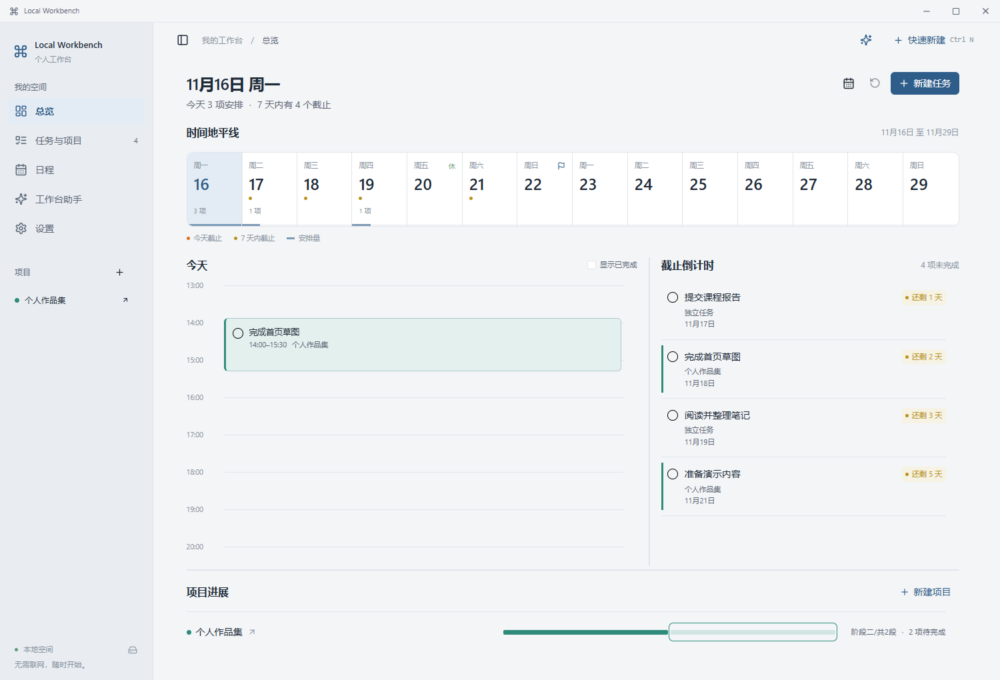
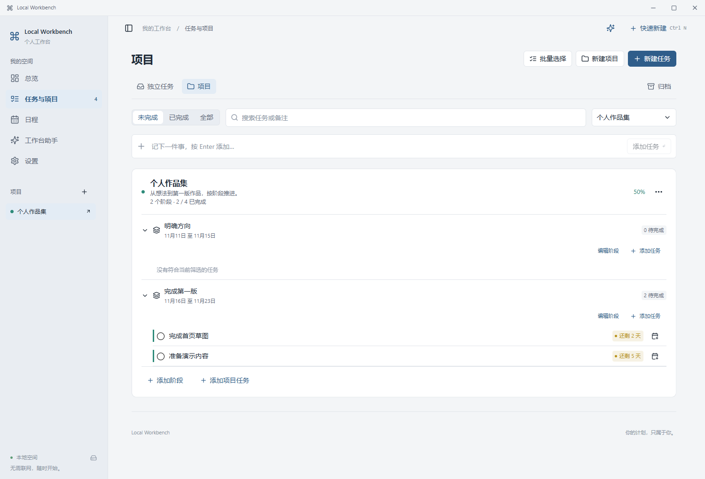
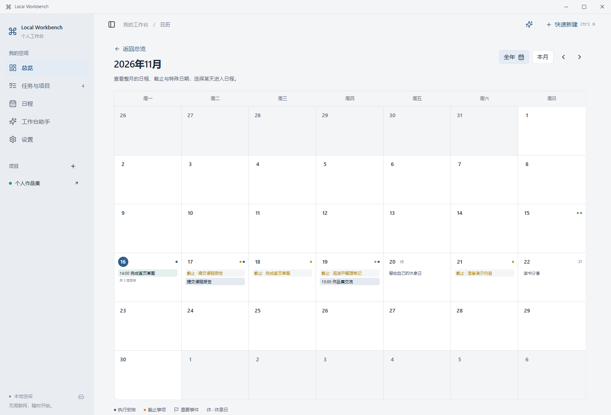
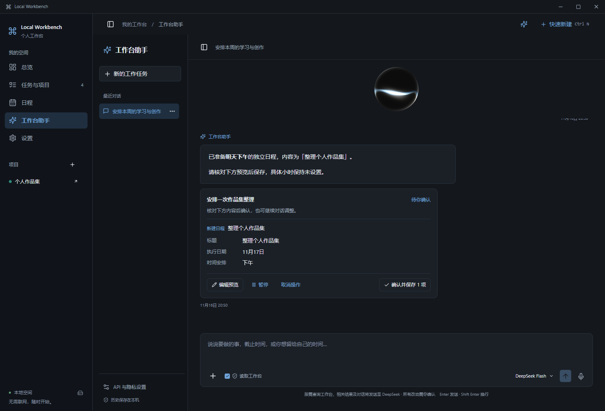

<p align="center">
  
</p>
<h1 align="center">Local Workbench</h1>
<p align="center"><strong>任务、时间与 AI，在你的本地工作台相遇。</strong><br />A local-first task & time workspace for Windows.</p>
<p align="center">
  <a href="https://github.com/JouCristian/Local-Workbench/releases/latest"></a>
  
  
  
  <a href="LICENSE"></a>
</p>
<p align="center">
  <a href="https://github.com/JouCristian/Local-Workbench/releases/latest">下载 Windows 版本</a> ·
  <a href="docs/USER-GUIDE.md">使用指南</a> ·
  <a href="docs/assistant-runtime.md">Agent 架构</a> ·
  <a href="https://github.com/JouCristian/Local-Workbench/issues">反馈问题</a>
</p>

---

**Local Workbench** 是一个轻量、本地优先的 Windows 个人任务与时间工作台。打开它，即可查看今天的安排、临近截止、项目阶段和未来日程；需要帮助时，可以通过自备 API Key 的 AI 助手查询、规划并准备操作。

**无需注册或登录本应用。** 任务管理可离线使用；AI 对话和语音识别需要联网、用户自己的 DeepSeek API Key 及相应服务额度，不提供共享密钥或免费推理额度。

> **v0.1.0 是首个正式公开、冻结的无需应用登录版本。** 对应源码、tag 和 Release 安装包构成这一版本的固定基线。

## 看见今天，也看见接下来



_截图由实际应用组件使用虚构通用数据渲染，不连接个人数据库或付费 API。首次启动为空工作台，不会自动注入截图中的内容。_

<table>
  <tr>
    <td width="50%"><br /><strong>从项目阶段，落到具体任务</strong></td>
    <td width="50%"><br /><strong>从整月概览，进入每天的安排</strong></td>
  </tr>
</table>

## 能用它做什么

| 能力            | 日常使用                                                                             |
| --------------- | ------------------------------------------------------------------------------------ |
| **总览**        | 14 天时间地平线、24 小时今日安排、截止倒计时、项目阶段进展；可调整区域比例并记住布局 |
| **任务与项目**  | 独立任务、项目和阶段分组；优先级、可选 DDL、状态筛选、批量操作、归档与恢复           |
| **日程与日历**  | 单条或关联任务的多次执行；上午/下午/晚上、精确时刻、月历/年历、重要事件与休息日      |
| **AI 工作伙伴** | Markdown 流式对话、实时查询本地业务、准备新增/修改/删除/批量操作，支持多轮调整和暂停 |
| **语音输入**    | 点击录音、停止识别、可编辑回填、手动发送；录音胶囊与相邻按钮同步过渡                 |
| **本地数据**    | SQLite 持久化、版本迁移、JSON 导入导出、恢复前备份；无应用账号或云同步依赖           |
| **外观与交互**  | 浅色/深色/跟随系统、7 种强调色、字体大小、侧栏收放、自绘日期控件、减少动态效果支持   |

任务截止和执行安排分别管理。一项任务可以安排多次，完成某次日程不会自动完成整个任务；归档也不会改变完成状态。

## AI 帮你准备，由你确认



可以试着说：

- “明天下午和晚上，各安排一次集中学习。”
- “查询本周截止的未完成任务，先别修改。”
- “把刚才的安排改到后天，备注保留。”
- “结合现有安排，建议哪一天适合休息，先给我方案。”

助手运行在原生进程内，使用 Function Calling 自行组合查询和操作预览。**业务事实来自 SQLite，业务写入必须点击表单确认。** 模型不能直接执行 SQL 或跳过确认保存。

- 表单可跨轮修改、暂停、继续、取消；手动字段按增量保留。
- 最新表单放在当前相关回复下，旧入口变为只读引用，不重复创建任务。
- 替换旧方案采用原子操作；校验失败保留原方案。
- 语义可以补拟标题，但不凭空生成日期、关联对象或模糊时段的小时。
- 语音只回填输入框，不自动发送；识别服务有独立的按音频时长计费。

[了解 Agent 架构与边界](docs/assistant-runtime.md) · [62 个多轮验收场景](docs/assistant-agent-testing.md) · [语音使用说明](docs/VOICE-INPUT.md)

## 下载与开始使用

1. 打开 [Releases](https://github.com/JouCristian/Local-Workbench/releases/latest)。
2. 下载 Windows x64 安装包，运行安装。
3. 启动后直接创建任务；无需登录。
4. 如需 AI，在「工作台助手 → API 与隐私设置」中填入自己的 DeepSeek API Key。

**系统要求**：Windows 10/11 x64。安装包携带 WebView2 离线安装器，已有 Runtime 时按安装器提示处理。发行包未做代码签名，Windows 可能显示未知发布者提示；请核对仓库来源和 Release 中的 SHA-256 校验文件。

也提供应用 EXE 的 ZIP 包，适用于已安装 WebView2 的系统。它仍将数据写入系统应用目录，**不是数据随身携带模式**；解压到其它文件夹不会隔离数据库。

### 常用快捷操作

| 操作            | 快捷键                  |
| --------------- | ----------------------- |
| 新建任务        | `Ctrl+N`                |
| 打开工作台助手  | `Ctrl+J`                |
| 发送消息 / 换行 | `Enter` / `Shift+Enter` |
| 取消语音输入    | `Esc`                   |

## 你的数据在哪里

```text
%APPDATA%\org.localworkbench.desktop\workbench.db
%APPDATA%\org.localworkbench.desktop\backups\
```

- 任务、日程、对话及偏好在本机 SQLite 中，重启保留。数据库和业务备份目前未加密。
- API Key 存在 Windows 凭据管理器，不回读到前端，不写入业务导出。
- 核心任务管理不需要联网。开启 AI 读取后按需发送查询结果；不预先上传整库。
- 关闭「读取工作台」限制后续业务访问，**不抹除当前对话已经分享的消息、附件和预览**。
- 点击语音录音并结束后，音频发送到 DeepSeek ASR；原始录音不长期落盘。取消不能撤回已上传内容或已产生费用。
- 没有应用账户、后台云同步或遥测。AI 服务的费用与数据处理适用供应商规则。

> **JSON 导入是完整替换，不是合并。** 恢复前自动备份原业务数据，写入使用事务；业务 JSON 不包含助手历史、API Key 和设备外观偏好。请另行妥善保管自己的备份。

公开示例位于 [`examples/generic.json`](examples/generic.json)。个人数据请放在被忽略的 `private/` 或使用 `*.local.json` 后缀；仓库与安装包不附带个人计划。

## 本地开发

需要 Node.js 22.12+（建议 Node 24 LTS）、npm、Rust stable MSVC、Visual Studio C++ Build Tools/Windows SDK 和 WebView2。

```powershell
git clone https://github.com/JouCristian/Local-Workbench.git
cd Local-Workbench
npm ci
npm run tauri dev
```

`npm run dev` 只启动 Vite，普通浏览器没有 Tauri SQLite 能力，不能作为完整桌面应用使用。

```text
src/
  domain/                 业务类型、日期、校验与防重
  data/                   SQL 仓储和原生 IPC
  components/assistant/   对话、操作预览和语音状态
  pages/                  总览、任务、日程、日历、设置
src-tauri/
  migrations/             12 个版本化迁移
  src/                    Agent、原生事务、凭据和麦克风采集
scripts/                  桌面、语音、发行验收脚本
examples/                 公开通用数据
```

### 验证与构建

```powershell
npm test
npm run build
cargo test --manifest-path src-tauri/Cargo.toml --lib
cargo check --manifest-path src-tauri/Cargo.toml --lib
npm run tauri build
```

桌面验收需要带 CDP 的 Tauri 窗口；真实模型测试默认跳过，按需单独执行并会消耗 API 额度。详细命令见 [Agent 验证说明](docs/assistant-runtime.md) 和 [语音验证说明](docs/VOICE-INPUT.md)。

## 当前边界

v0.1.0 聚焦可日常使用的本地工作流，目前没有系统通知、重复任务规则、撤销历史、跨设备同步、自动更新或离线 AI 模型。语音识别先整段录音再返回文字，单段最多两分钟，没有实时字幕或语音播报。跨午夜日程需拆分；AI 仍可能理解偏差，操作前请核对预览。

后续开发在新版本进行，发布 tag 保留冻结基线。发现问题请提交 [Issue](https://github.com/JouCristian/Local-Workbench/issues)，附上复现步骤、预期、实际及版本；不要上传密钥、真实数据库或未经处理的个人截图。

## 许可与致谢

本项目原创代码使用 [MIT License](LICENSE)。React Bits 的 Strands、Thought Line、Lattice Loader、Voice Pill 等适用其 **MIT + Commons Clause** 条款，不由本项目 MIT 许可重新授权。完整说明见 [第三方许可](THIRD_PARTY_NOTICES.md) 与 [许可原文](licenses/react-bits-LICENSE.md)。

感谢 Tauri、React、SQLite、Motion、Lucide 与 React Bits 提供的基础能力。
